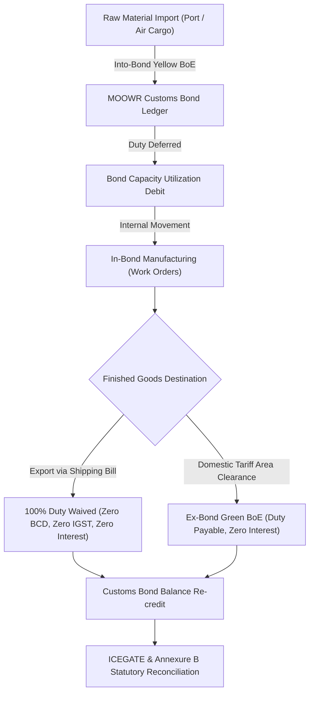

# Frappe Customs Bonded Warehouse & MOOWR Scheme Engine

[](https://frappeframework.com/)
[]()
[]()
[](LICENSE)

## 📌 Executive Overview & Real-World Client Problem

Under Section 65 of the Indian Customs Act, 1962, the **MOOWR (Manufacturing and Other Operations in Warehouse Regulations)** scheme permits manufacturing units to import capital goods and raw materials into a private bonded warehouse with **100% duty deferment** (both Basic Customs Duty and IGST).

However, manufacturers face acute statutory risks:
1. **Audit Disallowance of Duty Deferment:** Failure to maintain real-time double-entry reconciliation between Into-Bond Bills of Entry (Yellow BoE) and Ex-Bond Dispatches (Green BoE).
2. **Interest Liability Trap:** While MOOWR waives Section 61 interest on deferred duty indefinitely until clearance, any misclassification between export goods (100% duty waiver) and domestic clearance triggers retrospective interest penalties.
3. **Scrap & Wastage Norms Dispute:** Customs audits mandate strict Annexure A/B registers accounting for input-output consumption and production scrap.

This Frappe application implements a compliant customs bonded warehouse ledger, ensuring zero audit exposure during Directorate General of Audit (Customs) verifications.

---

## 🏛️ System Architecture Flow



---

## 🚀 Key Engineering Capabilities

- **Customs Bond Capacity Ledger:** Automatically monitors total bonded limit against accumulated BCD + Social Welfare Surcharge (SWS) + IGST deferred liabilities.
- **Bill of Entry (BoE) Split Allocator:** Tracks FIFO consumption of raw material lots into specific manufacturing batches.
- **Zero-Interest Domestic Clearance:** Accurately computes customs duty without applying traditional Section 61 commercial warehouse interest charges.
- **100% Export Waiver Certificate:** Generates automated Customs Annexure A & B statutory returns linked with ICEGATE Shipping Bills.

---

## 📂 Frappe DocType Schema & Data Structure

```text
customs_moowr/
├── customs_moowr_core/
│   ├── doctype/
│   │   ├── moowr_bond_entry/
│   │   │   ├── moowr_bond_entry.json
│   │   │   ├── moowr_bond_entry.py
│   │   │   └── moowr_bond_entry.js
│   │   └── moowr_annexure_b/
│   │       └── moowr_annexure_b.json
│   └── workspace/
│       └── customs_moowr_workspace/
│           └── customs_moowr_workspace.json
```

---

## ⚡ Frappe Hooks & Whitelisted APIs

- **REST Endpoint:** `POST /api/method/customs_moowr.api.process_into_bond_entry`
- **Whitelisted Method:** `@frappe.whitelist() def discharge_ex_bond_export(boe_number, export_qty, shipping_bill_no)`
- **Hooks Event:** `on_submit` of `Stock Entry (Manufacture)` updates the In-Bond consumption register.

---

## 🛠️ Installation & Bench Setup

```bash
# 1. Fetch app into Frappe Bench
bench get-app https://github.com/shyampandey1104/frappe-customs-bonded-warehouse-moowr

# 2. Install on target site
bench --site erp.yourdomain.com install-app customs_moowr

# 3. Migrate & run tests
bench --site erp.yourdomain.com migrate
python3 -m unittest discover tests
```

---

## 📄 License
MIT License. Tailored for export-oriented manufacturers, electronics assembly units, and pharma plants in India.
